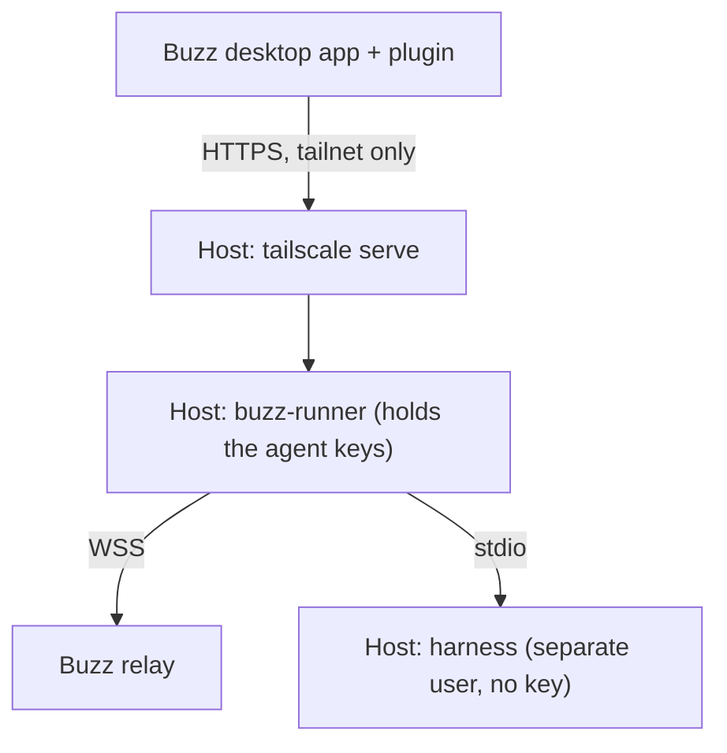

# buzz-plugin-tailscale-host

Run Buzz agents on your own Linux hosts in a Tailscale network (tailnet),
not on your desktop. The agents keep working while your desktop sleeps.

## What it does

The project has two parts:

| Part | Runs on | Job |
| --- | --- | --- |
| Plugin `sagmans.tailscale-host` (`plugin/`) | The Buzz desktop app | Adds the agent type "Tailscale host". Create, settings, rename, Stop and delete call the runner on the host. |
| Runner `buzz-runner` (`runner/`) | A Linux host, as a systemd service | Makes and keeps the agent keys, listens to the relay, and runs each turn with a harness: Claude Code, Codex, Goose or Pi. |



- The agent key is made on the host and never leaves it. The desktop app
  signs only the owner proof (NIP-OA) when you create the agent.
- A hosted agent gets the same harness, model, thinking and sessions
  choices as a desktop agent. You can change the harness later.
- The runner reuses the harness code of the Buzz desktop app unchanged, so
  hosted agents act as desktop agents do.

[docs/RUNNER_CONTRACT.md](docs/RUNNER_CONTRACT.md) has the contract and the
security design. [docs/HARNESSES.md](docs/HARNESSES.md) lists what differs
from a desktop agent.

## Requirements

- The Buzz desktop app with plugin API version 1.
- A Linux host with systemd, Node.js 24 or newer, and Tailscale. The host
  must be a tagged node (see Security).
- Node.js 24 or newer on the computer that builds the plugin.

## Install

Do these steps in this order:

1. Set up the runner on each host. Follow
   [runner/README.md](runner/README.md), section "Deploy". It installs the
   service, two system users and the sudo rules, then shows the
   `tailscale serve` command.
2. Build the plugin with your host list (see "Configuration").
3. Install the built plugin in the desktop app.

### Build the plugin

Buzz lets a plugin reach only the exact origins in its manifest. Your hosts
are therefore not in the source; you build the plugin with them:

```sh
cp hosts.example.json hosts.json   # then put your hosts in hosts.json
node scripts/build-plugin.mjs      # writes dist/manifest.json and dist/plugin.js
```

The build checks `hosts.json` and stops with the file and field to fix.
`hosts.json` and `dist/` are not tracked by Git.

### Install from a folder

1. Open **Settings > Plugins > Manage plugins** and load a folder.
2. Select the `dist/` folder, then select **Install**.

To update, build again. In **Manage plugins**, select **Tailscale host
agents** (the row, not its menu), then select **Update**.

### Install from Git

The Git install reads a folder from a repository. The built `dist/` holds
your host names, so do not publish it:

1. Fork this repository as a private repository.
2. Build the plugin in your fork, remove `/dist/` from `.gitignore`, and
   commit `dist/`. Keep `hosts.json` out of Git.
3. In **Manage plugins**, add your fork by its SSH URL
   (`git@github.com:<you>/<fork>.git`). The app uses your SSH agent for a
   private repository; an HTTPS URL cannot carry credentials.
4. Select the `dist` folder, then select **Install**.

With a Git install, a change on the Settings page builds only your local
`dist/`. Commit and push it, then select **Update**.

## Configuration

`hosts.json` lists the hosts that the plugin can reach (at most 16):

| Key | Rule | Example |
| --- | --- | --- |
| `id` | Lowercase letters, digits and `-`, at most 32 characters. Saved with each agent; do not change it later. | `example-host` |
| `label` | Shown in the app, at most 40 characters. | `example/host` |
| `origin` | `https://` origin of the host's `tailscale serve`, no path. | `https://runner-host.example.ts.net:10000` |

The first host is the default for new agents.

### Hosts in the app

`hosts.json` is the one host list. Open **Settings > Plugins > Tailscale
hosts** to see its hosts with their address and status, and to change it:

| Action | Rule |
| --- | --- |
| Add | A name (at most 40 characters) and the `https://` address of the host's `tailscale serve`, with no path. |
| Edit | Changes the name or the address. The host keeps its id, so its agents keep it. |
| Remove | Only when no agent of this device runs on the host. One host must stay. |

Each change writes `hosts.json` and builds `dist/` again. Buzz lets the
plugin reach only the origins of its installed build, so the change is in
use after you open **Settings > Plugins > Manage plugins**, select
**Tailscale host agents**, and select **Update**. Until then, the page
shows a new host as "Not in use until Update".

You can also edit `hosts.json` by hand or with a tool. Then build the plugin
(`node scripts/build-plugin.mjs`), or select **Build** on the page, and
select **Update**.

The page saves through `scripts/hosts-helper.mjs`. The build grants the
plugin one command: `node` on that script, with this `hosts.json` and
`dist/` as fixed arguments. Desktop finds `node` on your login shell's
`PATH` and stops the command after 5 seconds. If you move this folder,
build again.

The runner settings (users,
paths, harnesses, limits) are in [runner/README.md](runner/README.md),
section "Config". The install script takes its users and paths from
environment variables with generic defaults; the same README lists them.

## Use

1. Select **New agent** and the type **Tailscale host**.
2. Select the host (shown when there are two or more), the harness, the
   model and the thinking level. A harness that the host cannot run yet is
   shown but cannot be selected.
3. Create the agent. Mention it or send it a DM to start a turn.

If a host does not answer, the agents panel shows a notice, and the
agent's provider shows "Host unreachable".

## Mobile behavior

The Buzz mobile app runs no plugins, but hosted agents do not need them:

- Mentions, DMs and your thread replies from mobile wake hosted agents. The
  runner reads the relay directly, so the desktop app can be closed.
- To create an agent, change its settings or delete it, use the desktop
  app.

## Security

- Buzz plugins are not sandboxed. They run inside the app with its full
  access. Install only code that you trust, and read `plugin/plugin.js`
  first.
- The plugin asks for two native grants: network requests to the exact
  origins in your `hosts.json`, and one command that runs
  `scripts/hosts-helper.mjs` with `node` from your login shell's `PATH`.
  The plugin cannot reach other addresses or choose the program or its
  arguments. The helper runs with your user's access and writes only the
  `hosts.json` and `dist/` named in the build; it checks each request
  before it writes. A change to the helper in this folder runs at the next
  save without a new review in Desktop, so review changes before you pull
  them.
- The runner API has no TCP port. It listens on a Unix socket that only
  `tailscale serve` reaches, and it accepts only the Tailscale logins in its
  `allowedLogins`. Allow only your own devices to reach the host in the
  tailnet policy.
- Use a tagged node for the host. On an untagged node, a harness on the
  host can call the runner API through `tailscale serve` as you.
- Harnesses run as a separate Unix user through two narrow sudo rules. They
  never get an agent key. All agents on a host share that user, so they can
  read each other's workspaces and the harness sign-ins.
- Harness sign-ins stay on the host. You sign in on the host with
  `buzz-login`; keys never go through the plugin.

Report a security problem privately to the maintainers. Do not open a
public issue for it.

## Contributing

1. After you clone, run `scripts/setup-hooks` once. It turns on the Git
   hooks of this repository.
2. Install the tools that the hooks use: `gitleaks`, `node`, `pnpm`,
   `shellcheck`, `shfmt`, `markdownlint-cli2`, `lizard`, `semgrep`, `trivy`
   and `osv-scanner`.
3. Set up the runner toolchain once (a buzz-app clone at the pinned
   revision). [runner/README.md](runner/README.md), section "Build", has the
   steps.
4. Run `scripts/check` before you push. It builds the plugin from
   `hosts.example.json`, builds the runner, runs the smoke scenarios, the
   linters and the scanners. `scripts/check --quick` runs the fast part.
5. Sign each commit and add a sign-off: `git commit -s -S`. The commit
   message rules are in `.githooks/GIT_CONVENTION.md`.

All checks must pass before you push. Never use `--no-verify`.

## License

Apache License 2.0. See [LICENSE](LICENSE) and [NOTICE](NOTICE). Parts of
the runner and the harness marks come from Buzz (block/buzz-app); NOTICE
lists them.
