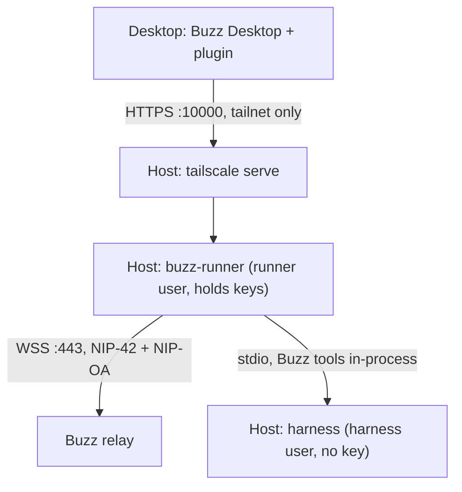

# Runner contract

This document describes how the `tailscale-host` plugin and `buzz-runner`
work together. It covers the parts, the hosted agent type contract that
Buzz Desktop calls, the runner behavior, the security design and the HTTP
API (contract v1).

Source facts come from `block/buzz-app` at the revision in
`runner/src/constants.ts` (`BUZZ_APP_REV`). Paths are relative to its
`src/` unless they say otherwise.

## 1. Parts

| Part | Runs on | Job |
| --- | --- | --- |
| Plugin `sagmans.tailscale-host` | The owner's desktop, in Buzz Desktop | Registers a hosted agent type (`RemoteAgentType`). Create, rename, Stop and delete call the runner. Desktop signs the NIP-OA owner proof |
| Runner `buzz-runner` | A Linux host on the tailnet, as a systemd service | Makes and keeps agent keys. Listens to the relay. Runs harness turns. Serves the Buzz tools to the harness |

Why two parts: plugins run only inside Desktop. A process must live on the
host to hold the key and run turns while the desktop sleeps.

## 2. Hosted agent type contract (Desktop side)

`features/agents/service.ts` defines the contract. Desktop calls these, and
each step is safe to repeat:

| Call | Plugin does | Runner endpoint |
| --- | --- | --- |
| `provision({name, picture?, community})` | Asks the runner for a new key | `POST /v1/agents` returns `{pubkey}` |
| `activate({pubkey, name, community, auth})` | Passes the NIP-OA tag | `POST /v1/agents/{pk}/activate` (publish kind 0, start the listener) |
| `profile({pubkey, name, picture})` | Rename | `PUT /v1/agents/{pk}/profile` |
| `interrupt({pubkey, channelId, threadRootId})` | Stop button | `POST /v1/agents/{pk}/interrupt` |
| `remove({pubkey})` | Delete | `DELETE /v1/agents/{pk}` (stop, delete the key) |

NIP-OA tag: `["auth", ownerHex, "", sig]`. The signature is over
`sha256("nostr:agent-auth:<agentPk>:")` (`src-tauri/src/identity.rs`).
Settings (instructions, harness, model, effort, sessions) are saved by the
plugin to the runner with `PUT /v1/agents/{pk}/config`.

Hosted agents get no Desktop attention (watches, timers). Mentions, DMs and
owner thread replies wake them.

## 3. Runner behavior (same as the Desktop harness)

| Item | Desktop source | Runner |
| --- | --- | --- |
| Wake rule | `features/agents/runner.ts`, `attention.ts` | Kinds 9, 40003, 40007, 46010 with `p` = agent, not self; 1:1 DM kind 9 |
| Sender gate | `runtime.ts` `fromOwner()` | Owner-authored, or a valid `auth` tag that names the owner. Others are dropped |
| Turn text | `bundled/claude-code/prompt.ts` `turnPrompt` | Same `<context>`, thread context and `<buzz-event>` |
| System prompt | `bundled/claude-code/prompt.ts` | Same `<identity>`, `<base>`, `<agent-instructions>` |
| `claude` launch | `bundled/claude-code/claude.ts` | Same flags: stream-json in and out, `--permission-mode bypassPermissions`, `--resume`/`--session-id`, `--mcp-config` type `sdk` |
| Codex, Goose, Pi | `bundled/{codex,goose,pi}` | Same clients and settings rules, imported unchanged (see [HARNESSES.md](HARNESSES.md)) |
| Buzz tools | `bundled/claude-code/claude.ts`, `buzz-mcp/rpc` | Served in the runner process. The harness process never gets the key |
| Sessions | `bundled/claude-code/sessions.ts` | One per thread (`channel/<root>`) or per channel, `--resume`, idle stop after 15 min |
| Steer | `prompt.ts`, `sessions.ts` | A new message during a busy turn steers it |
| Turn end | `send` with `final:true` | Same `final` hook |

Build: the runner bundles the buzz-app modules above at the pinned revision,
so it reuses the exact logic. The build runs from a separate clone; the
runner never edits buzz-app.

Relay live feed: buzz-app's `nodeClient` has no subscribe (HTTP only). The
runner has its own NIP-42 WebSocket (Node 24 has a built-in `WebSocket`).

Relay live scope: a REQ without `#h` gets a community-global live scope and
never receives channel events live; it returns only stored events
(buzz-relay `handlers/req.rs`, `subscription.rs`). So the runner's mention
REQ carries `#h` = the agent's channels from the relay-signed rosters. It is
sent again on join or leave, and renewed every minute when it holds several
channels (Desktop does the same, `relay/live.ts`).

Membership changes: the relay keeps rosters (kind 39002) in their channel's
scope, so the membership REQ gets them at connect only. A join or leave after
the connect reaches the runner as a relay-signed membership notice (kind
44100 added, 44101 removed; buzz-relay `side_effects.rs`
`emit_membership_notification`). The runner subscribes to them live
(`limit: 0`, plus a `#t:["system"]` filter for system channels). The
notice's channel joins or leaves the mention scope at once, as in buzz-acp
and Desktop. The relay sends the add notice before it stores the new roster,
and it answers a REQ without `#h` from a member-channel cache that lives
10 s. So the runner loads all rosters again 12 s after the last notice, for
the full rosters that one-to-one DMs need. The new rosters replace the old
ones. A roster load that gets no EOSE in 15 s replaces the socket.

## 4. Security design

| Threat | Control |
| --- | --- |
| Other tailnet nodes call the runner | The tailnet policy allows only the owner to reach the host on port 10000. The runner also checks `Tailscale-User-Login` against `allowedLogins` (set by `tailscale serve`, which local users cannot forge because the socket is private). Fail closed |
| A harness calls the runner through `tailscale serve` on its own host | The host must be a tagged node. Serve adds no identity headers for traffic from a tagged node, so the call has no login and gets 403. On an untagged node it would carry the owner's login |
| Public internet | The API has no TCP listener: a Unix socket only, exposed with `tailscale serve`. Use no public ingress on the host |
| The model reads an agent key | Two Unix users. The runner user owns the keys (0600 files in a 0700 state directory). Every harness runs as the harness user through two narrow sudoers lines. One workspace per agent. Tools are served in the runner, so no key is in the harness environment or files |
| A harness sign-in leaks through the plugin | **Sign in** runs `buzz-login` over Tailscale SSH, pinned to the host keys that Tailscale reports, with fixed commands only. Add host gives its login a sudo rule for `buzz-login` only, as the harness user, so sudo asks no password. On an older setup, the sudo password goes only to sudo's prompt, once. Typed keys go only to the terminal. The helper never saves or logs them and masks them in the output that the page shows |
| Agents read each other's data | Agents share the harness user, so they can read each other's workspaces and the shared harness sign-ins. Accepted for one owner; one Unix user per agent would close it |
| An agent reaches other servers | Restrict the host's outbound access in the tailnet policy to the relay |
| Strangers wake an agent | The sender gate admits the owner, `allowedSenders`, and (with `acceptAttested`) agents with a valid owner `auth` tag |
| Runaway process | systemd `Restart=on-failure`, `ProtectSystem=strict`, `MemoryMax`, `TasksMax`; per-turn time limit; `maxParallelTurns`, `maxLiveSessions` |
| Privilege gain from a harness | Wrappers run `setpriv --no-new-privs --inh-caps=-all`, `prlimit --core=0 --nproc`, `oom_score_adj` 1000, with an environment rebuilt from nothing |
| Supply chain | Pinned buzz-app revision. The runner's own lockfile for its build tools and bundled libraries, with a 14-day minimum release age; the build refuses a buzz-app import that the runner does not declare. Pinned harness versions at fixed paths, installed by root. No runtime package installs |
| Key loss on host rebuild | Accepted. The agent is created again. A key never leaves the host |

## 5. Runner contract v1 (plugin to runner)

Transport: the plugin sends each call to its hosts helper
(`scripts/hosts-helper.mjs`, a Desktop host process). The helper sends it to
the host's origin in `hosts.json` (for example
`https://runner-host.example.ts.net`), on port 10000 when the origin names
no port, then
`tailscale serve`, then the runner's Unix socket. JSON bodies,
`Content-Type: application/json`. Errors are
`{ "error": "<code>", "message": "<text>" }` with 4xx or 5xx.

Authorization on every request (fail closed): the header
`Tailscale-User-Login` must be in `allowedLogins`. A missing header (a direct
socket call without `tailscale serve`) gets 403.

| Method and path | Body | Success | Notes |
| --- | --- | --- | --- |
| `GET /v1/health` | — | `200 {ok:true, version, agents}` | |
| `GET /v1/harnesses` | — | `200 {harnesses:[...]}` | In config order, with readiness |
| `GET /v1/harnesses/{id}/models` | — | `200 {current, models}` | Desktop's labels |
| `POST /v1/agents` | `{name, picture?, community}` | `200 {pubkey, picture?}` | `community` must be in `relays`. Idempotent: a not yet activated agent with the same `name` and `community` is returned again |
| `GET /v1/agents/{pk}` | — | `200 {pubkey, name, picture?, community, activated, config, workspace}` | 404 when absent |
| `POST /v1/agents/{pk}/activate` | `{name, community, auth, config?}` | `204` | `auth` must be `["auth", ownerPubkey, "", sig]` with a BIP-340 signature over `sha256("nostr:agent-auth:<pk>:")`. Then kind 0 is published and the agent starts. Safe to repeat |
| `PUT /v1/agents/{pk}/profile` | `{name, picture?}` | `204` | Publishes kind 0 again |
| `PUT /v1/agents/{pk}/config` | `{instructions?, model?, effort?, harness?, scope?}` | `204` | Applies to new sessions |
| `POST /v1/agents/{pk}/interrupt` | `{channelId, threadRootId}` | `200 {interrupted:bool}` | |
| `DELETE /v1/agents/{pk}` | — | `204` | Stops the agent and deletes the key file. Absent gives 204. The workspace is kept |

`config` shape: `instructions` (at most 20000 characters), `model`,
`effort`, `harness` (`claude-code`, `codex`, `goose`, `pi`) and `scope`
(`thread` or `channel`). [`runner/README.md`](../runner/README.md) has the
full rules and error codes.

## 6. Defaults that keep agents talking

| Setting | Default | Effect |
| --- | --- | --- |
| `acceptAttested` | `true` | As Desktop: a mention from an agent with a valid owner `auth` tag (desktop agents and hosted siblings) wakes an agent. `false`: only the owner and `allowedSenders` |
| `attestEvents` | `true` | Published chat events carry the owner `auth` tag, so desktop and hosted agents wake each other. `false`: only the kind 0 profile carries it |
| `replyWake` | `true` | The owner's untagged thread reply wakes the agent it is for, as the `sagmans.reply-wake` plugin does for desktop agents |

For a closed host set `acceptAttested` and `attestEvents` to `false`.
